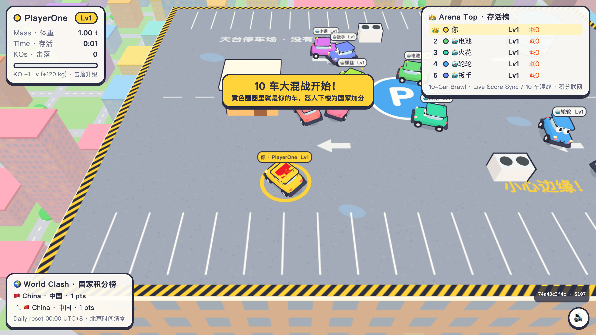

# World Clash 🌍🚗💨

👉 **Live Demo**: <https://app-worldclash-dev-39ca.azurewebsites.net/> — *Feel free to try it, very fun!*



---

## English

**World Clash** is a 3D cartoon rooftop bumper-car brawl (`rooftop-bumpers/`) built with Node.js and Three.js.

### Why Local-First + Cloud Country Leaderboard?
This started as a quick ~15-minute idea. I originally tried turning it into a real-time cross-country online PvP physics game, and failed — **internet latency is still a real physical barrier blocking tight, zero-lag bumper-car collisions**. So it pivoted to a **local-first 10-car brawl with a real-time online country leaderboard**:
- **Zero-Latency 10-Car Brawl**: Your car and 9 flag-bearing AI opponents run natively in your browser at 60Hz/120Hz with instant collisions and zero rubber-banding.
- **Live Global Country Scoreboard**: Every knockout (`💥`) you score is synced in real time via WebSocket to the cloud leaderboard for your chosen country or region. Whichever country has more players smashing cars off the roof climbs the global ranks!

### Run Locally
```bash
cd rooftop-bumpers
npm ci
npm start
# Open http://localhost:3000
```

---

## 中文说明

**World Clash（世界大对撞）** 是一款 10 车天台碰碰车混战游戏（位于 `rooftop-bumpers/`）。

### 灵感与架构演进
这是一个突发奇想的 idea，大概花了 15 分钟做出来的原型。原本试着把它做成不同国家实时在线物理对战，失败了——**没想到跨地域互联网延迟（Internet latency）依然是强耦合碰撞体验难以逾越的物理阻碍**。因此最终改为**本地优先的 10 车单机混战 + 全球国家积分实时联网同步排行榜**：
- **10 车纯本机丝滑混战**：入场即刻在浏览器本机生成 10 辆车（你 + 9 辆各国旗帜 AI 对手），60Hz/120Hz 零延迟碰撞，无网络回扯。
- **全球国家积分实时同步**：每次将对手怼下天台，都会为所选国家或地区真实 +1 分并实时同步至云端排行榜（哪个国家玩的人多、撞得猛，积分就自然高）。

---

## Azure Deployment Target / 云端部署信息

- **Live URL**: <https://app-worldclash-dev-39ca.azurewebsites.net/>
- **Resource Group**: `rg-worldclash-dev-39ca` (`eastasia` / Hong Kong)
- **App Service**: `app-worldclash-dev-39ca` (Plan: `asp-worldclash-dev-39ca`, F1 Free)
- **Infra Templates**: [`infra/`](./infra/)
- **Deploy Command**:
  ```bash
  az webapp deploy --resource-group rg-worldclash-dev-39ca --name app-worldclash-dev-39ca --src-path <archive.zip> --type zip
  ```

